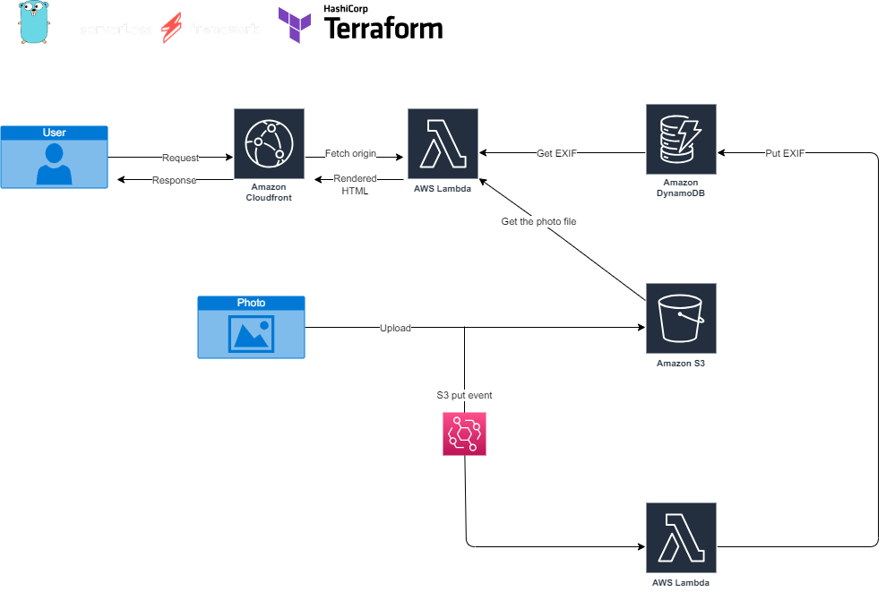

# lambda-image-viewer

A simple image viewer using AWS Lambda + CloudFront + DynamoDB + S3.

I used to use Flickr as a storage for blog images, but for several reasons (mainly financial), I needed an alternative. Therefore, I am prioritizing the implementation of features that are essential for my personal use.

## Features

### CDN

route: `<CDN Domain>/.../foo.jpg`

- Provides a standard S3-backed CDN via CloudFront.
- Private mode: Images in a `private` folder require a CloudFront signed URL.

### Image Viewer

route: `<Viewer Domain>/image/.../foo.jpg`


- Shows an image info (EXIF).

### Camera Roll (Admin Page)

route: `<Viewer Domain>/cameraroll/`


- You can list all uploaded images.
- Basic auth.
- Private images (`/private/*.jpg`): only accessible from camera roll page.

## Structure



- The viewer does not use ALB but Lambda Function URLs.
- S3-event-driven Tagger gets EXIF by a photo and puts to DynamoDB.


## Requirements

- Serverless Framework v3.34
- Terraform v1.12 or above
- Go 1.21
- AWS

You can also use **env to install easily.

- [tsubasaogawa/slsenv](https://github.com/tsubasaogawa/slsenv)
- [tfutils/tfenv](https://github.com/tfutils/tfenv)
- [go-nv/goenv](https://github.com/go-nv/goenv)

## Usage

### Clone

```bash
git clone https://github.com/tsubasaogawa/lambda-image-viewer.git
```

### Deploy Lambda

```bash
cd src/viewer

# Configure the values in .env; see "Private image signing" below.
cp -p .env.tmpl .env
vim .env

# The initial signing key ID can be UNCONFIGURED until Terraform creates the key.
serverless deploy

serverless info
```

### Deploy Infrastructure

```bash
cd ../../terraform

# Fix environments.
cp -p terraform.tfvars.tmpl terraform.tfvars
vim terraform.tfvars

terraform init
terraform apply

# Set CLOUDFRONT_SIGNING_KEY_ID to the cloudfront_signing_key_id output,
# then deploy Lambda again.
cd ../src/viewer
serverless deploy
```

The viewer Function URL requires IAM authorization. CloudFront accesses it through
OAC; requests to the Function URL without IAM authorization are rejected.

### Private image signing

Create an RSA 2048-bit key pair outside the repository. Store the private PEM in
AWS Secrets Manager without passing its contents as a command-line argument:

```bash
umask 077
openssl genpkey -algorithm RSA -pkeyopt rsa_keygen_bits:2048 -out /secure/path/cloudfront-private.pem
openssl pkey -in /secure/path/cloudfront-private.pem -pubout -out /secure/path/cloudfront-public.pem
aws secretsmanager create-secret --name <secret-name> --secret-string file:///secure/path/cloudfront-private.pem
```

Set `PRIVATE_SIGNING_KEY_SECRET_ARN` in `.env` to the secret ARN. Provide the
public PEM as `cloudfront_public_key` in `terraform.tfvars`, and set
`lambda_function_name` to the deployed viewer function name. Terraform outputs
the public key ID for `CLOUDFRONT_SIGNING_KEY_ID`. The viewer role can read
only the specified secret. If a customer-managed KMS key is used, grant that
role the necessary KMS decrypt permission as well.

Delete the local private key securely according to the host's storage policy.
Keep private keys out of Terraform variables, state, logs, source control and
deployment artifacts. Rotate keys during maintenance: update the secret and
Terraform public key, then deploy the new public key ID to Lambda and verify
access. Replacing the key immediately invalidates previously signed URLs.
Signed URLs are bearer credentials valid for 15 minutes; anyone holding one can
use it until it expires. Private image URLs refresh in the authenticated viewer.
Keys containing literal `%`, backslashes, control characters, empty path
segments or dot segments are not supported for private images.

### Migrate an existing deployment

The old salt and URLs must be treated as exposed. The migration interrupts
access until all edge locations have the new configuration.

1. Back up the DynamoDB table and Terraform state. Inventory existing public
   policies and clients that access S3 or the Function URL directly. Restrict
   those clients or migrate them to CloudFront.
2. Before deploying changes, attach a CloudFront-scoped AWS WAF web ACL that
   blocks viewer requests to **both** distributions, and wait for both
   distributions to finish deploying. Set `maintenance_web_acl_arn` to that
   same ACL ARN so Terraform retains the restriction during its update. Do not
   rely on DNS changes to block the CloudFront distribution domains.
3. Configure the signing secret and `.env` as above, initially using
   `CLOUDFRONT_SIGNING_KEY_ID=UNCONFIGURED`. Deploy the Lambda stack to enable
   IAM authorization. Public access through CloudFront can fail until its
   Lambda OAC and permissions have been deployed.
4. Configure the Terraform values and apply them while the WAF restriction is
   in place. Wait for both distributions to deploy. Set the actual public key ID
   in `.env` and redeploy the Lambda stack. Confirm that the Function URL is
   `AWS_IAM` and that no old public Lambda resource-policy grants remain.
5. Invalidate `/*` on both CloudFront distributions and wait for completion.
   The former salt and token URLs are no longer valid. Review whether Basic
   credentials were exposed and rotate them if necessary.
6. Reclassify existing DynamoDB records. First run the command without
   `--apply` and inspect the count; it only scans the table. After confirming
   the target and backup, run it again with `--apply`. Concurrent changes to a
   record cause an error rather than being overwritten.

   ```bash
   cd src/viewer
   AWS_REGION=<region> go run ./cmd/private-reindex --table <table-name>
   AWS_REGION=<region> go run ./cmd/private-reindex --table <table-name> --apply
   ```

   This only updates existing metadata records. Inventory S3 `private/` objects
   that are missing from DynamoDB or lack thumbnails separately. Reprocess
   those objects with the tagger and thumbnail functions after confirming the
   impact; `cmd/tagger-cli` rewrites metadata and does not create thumbnails.
   New `.jpg` objects in `private/` are now included in the tagger trigger.
   Allow time for the DynamoDB GSI to reflect updates.
7. Restrict the WAF ACL to a trusted test IP and verify public images, private
   image and thumbnail signatures, expiry and refresh, pagination, and private
   metadata. Verify anonymous Function URL and S3 requests are denied, including
   encoded and normalized path variants. Then remove the maintenance ACL
   through Terraform and verify again. If a check fails, keep access restricted;
   do not restore the old unauthenticated configuration.

CloudFront and Lambda configuration, deployment propagation, and historical
exposure must be checked in the actual AWS environment. Applying infrastructure
changes and updating existing data require separate operational approval.

### Upload photo

```bash
aws s3 cp <PHOTO FILE> s3://<CREATED S3 BUCKET>/<FILE NAME>
```

## Future Works

- Fix design
